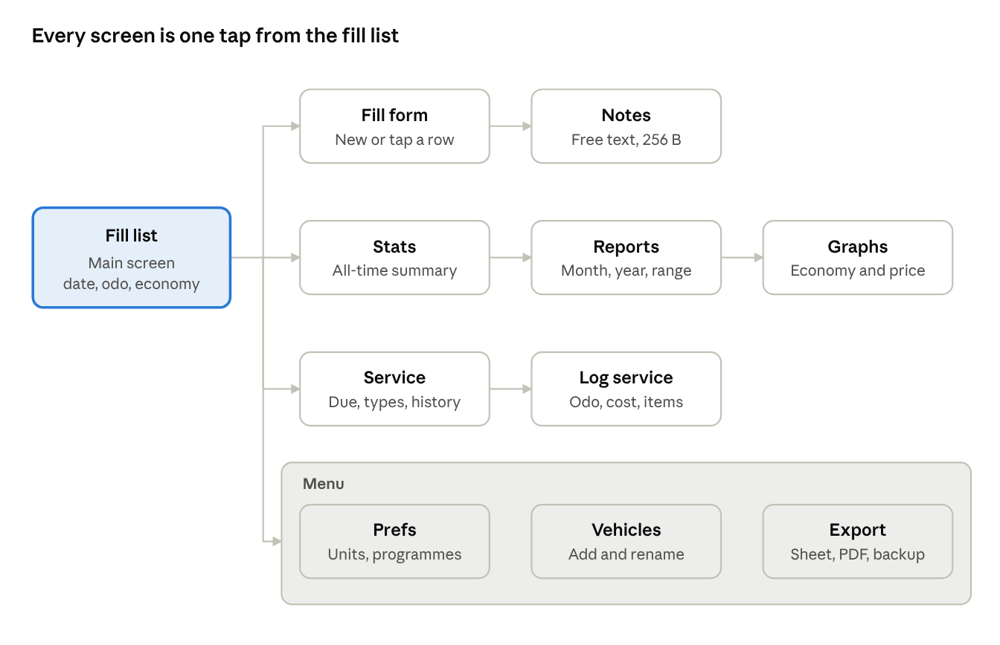
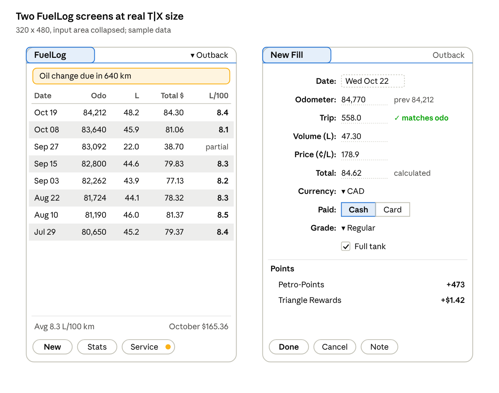

# FuelLog for Palm OS 5.4.9: Design Spec

Oct 21, 2026 · @Zoe Leto

## Overview

FuelLog replaces the four-page paper Fuel Log v2 with a native Palm OS app for the Palm T|X (Palm OS 5.4.9 Garnet). It records every fill-up in a few taps and turns the log into stats and reports on the device, with no desktop needed.

**Source form.** The paper log has seven columns: Date, Trip, Odometer, Fuel Amt., $/Gallon, KB Points (new points over cumulative points, split diagonally in one cell) and Notes. All seven map to fields, and the app adds what the paper cannot do: total cost, full-tank tracking, running points balance and derived economy.

**Target.** Palm T|X first: 320x480 hi-res screen, collapsible input area, 5-way navigator, SD slot. Built as a 68k app running under PACE, so it also runs on the LifeDrive and other OS 5 devices.

**In scope for v1**

- Fill-up entry, edit, delete, with notes
- Units switchable in Prefs (metric stored, display converted)
- Stats screen and period reports (month, year, custom range)
- Hi-res graphs of economy, price and spend; EV and plug-in hybrid charging alongside fuel; CSV, XLSX and XLS import of the paper logs
- Rewards points: earned, redeemed, running balance
- Service tracking: oil changes and other maintenance on distance and time intervals, with due warnings
- Export to SD card as a spreadsheet (CSV and XLSX) and as a PDF report; database backup and restore; IR and Bluetooth transfer

**Out of scope for v1:** a HotSync conduit and multiple users.

## Data model

Every value is stored as a metric integer in fixed point, so there is no floating point on the device and unit switching never changes stored data. Prefs only change how values are displayed and entered.

**Databases** (creator ID `ZFlg`; all-lowercase IDs are reserved by Palm)

| Database | Type | Contents |
| --- | --- | --- |
| FuelLog-ZFlg | `Data` | One record per fill-up, kept sorted by date then odometer |
| FuelVeh-ZFlg | `Vehi` | One record per vehicle |
| FuelPgm-ZFlg | `Pgms` | One record per rewards programme |
| FuelSvT-ZFlg | `SvcT` | One record per service type per vehicle (oil change, tyre rotation and so on) |
| FuelSvL-ZFlg | `SvcL` | One record per service visit, kept sorted by date |
| App prefs | via `PrefSetAppPreferences` | Display units, currency, current vehicle |

**Fill-up record** (packed, big-endian, fixed header then variable notes)

| Field | C type | Stored as | Paper column |
| --- | --- | --- | --- |
| date | `DateType` | packed date, 2 bytes | Date |
| flags | `UInt16` | bit 0 full tank, bit 1 missed previous fill, bit 2 trip entered | (new) |
| vehicle | `UInt8` | vehicle id (FuelVeh) | (new) |
| grade | `UInt8` | 0 regular, 1 mid, 2 premium, 3 diesel | (new) |
| odometer | `UInt32` | km x 10 | Odometer |
| trip | `UInt32` | km x 10, trip meter reading at the fill | Trip |
| volume | `UInt32` | millilitres | Fuel Amt. |
| price | `UInt32` | thousandths of a currency unit per litre (189.9 c/L = 1899) | $/Gallon |
| total | `UInt32` | cents | (new) |
| pointCount | `UInt8` | number of point entries that follow, 0 to 4 | KB Points |
| points\[\] | `{UInt8 pgm; Int32 earned; Int32 redeemed}` | one entry per programme used on this fill | KB Points, new |
| notes | `char[]` | null-terminated, up to 256 bytes | Notes |

Cumulative points are not stored: they are derived by walking records in date order, so editing an old fill can never leave a stale running total. The user enters any two of volume, price and total, and the app computes the third.

**Trip meter.** Trip is the trip meter reading at the fill. Each vehicle sets `tripMode` (`UInt8`): reset at every fill (the default for new vehicles, matching how you use it), never reset, or not used.

- **Reset at every fill:** the reading should equal the odometer change since the last fill. A gap of more than 2% (or 5 km) raises a soft warning on save, which catches a typo in either number or a fill you forgot to log. After saving, FuelLog reminds you to reset the trip meter.
- **Never reset:** the change in trip between fills is compared with the odometer change instead.
- **Quick entry:** leave the odometer blank and FuelLog fills it in as the previous odometer plus the trip, so at the pump you only read one number.

Trip is stored in km x 10 and entered in the vehicle's odometer unit, the same as the odometer.

**Selectable units.** Each dimension is chosen on its own in Prefs, so a mix such as km with Imperial MPG works. Values are always stored metric and converted at display and entry, so switching never rewrites data.

| Dimension | Choices | Factor to stored unit |
| --- | --- | --- |
| Distance | km, miles | 1 mi = 1.609344 km |
| Volume | litres, US gallons, Imperial gallons | 3.785411784 L; 4.54609 L |
| Economy | L/100km, km/L, MPG (US), MPG (Imp) | derived from L/100km |
| Price | per litre, per US gallon, per Imperial gallon, or per kWh; shown as dollars ($1.789/L, $3.459/gal) or cents (178.9 c/L, 345.9 c/gal), a separate Price format setting that also controls how price is typed | follows volume unless overridden |
| Currency | USD, CAD, EUR, AUD, NZD, GBP per fill; home currency in Prefs (see Currencies) | converted to home currency with the fill's stored rate |

**Per-vehicle odometer unit.** A car's odometer is physically in km or miles, so each vehicle stores its own odometer unit for entry. A US-market car with a miles odometer is typed in miles, stored in km and shown in whatever the display distance is. The Imperial gallon matters too: Canadian and UK drivers often quote MPG in Imperial gallons, which reads about 20% higher than US MPG for the same car.

**Currencies.** Each fill is recorded in the currency on its receipt, so a fill in Blaine or Bellingham stays in USD next to Surrey fills in CAD. Each fill also stores the exchange rate to the home currency at the time, so totals never shift when rates move later. Every fill record carries two extra fields after `total`:

| Field | C type | Stored as |
| --- | --- | --- |
| currency | `UInt8` | 0 USD, 1 CAD, 2 EUR, 3 AUD, 4 NZD, 5 GBP (room for more) |
| fxRate | `UInt32` | home units per fill unit x 1,000,000 (1.000000 when it matches home) |

| Code | Shown as | Excel number format | Notes |
| --- | --- | --- | --- |
| USD | `US$` | `[$USD] #,##0.00` |  |
| CAD | `C$` | `[$CAD] #,##0.00` | default home currency |
| EUR | `€` | `[$EUR] #,##0.00` | 0x80 in both Palm Latin and PDF WinAnsi, so it passes straight through |
| AUD | `A$` | `[$AUD] #,##0.00` |  |
| NZD | `NZ$` | `[$NZD] #,##0.00` |  |
| GBP | `£` | `[$GBP] #,##0.00` | 0xA3 in both Palm Latin and PDF WinAnsi, like the euro |

- **Home currency** is set in Prefs, and all stats, reports, graphs and cost-per-100 km figures are in home currency.
- **Default currency** for new fills and service visits is also set in Prefs, separately from home currency. It can be a fixed currency or "last used". Each vehicle can override it (`defaultCurrency`, `UInt8`, 255 = use Prefs), so a car kept in Washington defaults to USD while reports stay in CAD. The order is vehicle override, then Prefs default, then last used.
- **Rate table** in Prefs holds the last rate used for each currency. A new fill pre-fills the rate from that table, and you can type over it from your card statement.
- **Reports** add a per-currency breakdown (spend in original currency) under the home-currency totals.
- **Exports** carry three columns: original amount, currency code and home-currency amount. XLSX cells get the matching currency number format.
- Decimal and thousands separators follow the device's Formats preference (`LocGetNumberSeparators`), so a European device reads 1.234,56.

**Payment method.** Each fill records how it was paid, with one more field after `fxRate`: `payment` (`UInt8`, 0 Cash, 1 Card). The fill form shows it as a two-button push group that defaults to the last method used. Reports and the Stats screen split spend by Cash and Card, and exports add a Payment column. A rewards programme can be tied to a payment method (a `requiresPayment` field on the programme record), so credit card points auto-apply only on Card fills and never on Cash ones.

**Electric and plug-in hybrid.** Charging sessions sit in the same log as fill-ups, so one vehicle list and one set of reports covers the whole household.

| Change | Detail |
| --- | --- |
| Vehicle `powertrain` (`UInt8`) | 0 fuel, 1 hybrid, 2 plug-in hybrid, 3 electric; sets which entry kinds the fill form offers |
| Vehicle `batteryWh` (`UInt32`) | usable capacity, used to warn on an impossible charge |
| Fill `flags` bit 3 | 1 = charging session; then `volume` holds Wh, not mL |
| Fill `price` | thousandths of a currency unit per kWh for charges; 0 is allowed for free charging |
| Fill `grade` for charges | 4 home AC, 5 public AC, 6 DC fast |
| Fill `flags` bit 0 for charges | "charged to full", which plays the same role as a full tank |

- **Units.** Energy is entered in kWh. Economy is kWh/100 km, mi/kWh or Wh/km, with optional MPGe (33.705 kWh per US gallon).
- **EV economy** is calculated full charge to full charge, the same as a fuel tank. When sessions are rarely full, it falls back to a period figure (total kWh over total distance for the month).
- **Plug-in hybrids** share one odometer between fuel and electricity, so per-tank economy would mislead. They get period figures: L/100 km, kWh/100 km, and a combined **energy cost per 100 km** in home currency, which is the honest comparison between the two.
- **Home charging** pre-fills the price from a home rate per kWh in Prefs. You type the rate from your hydro bill; nothing is hardcoded.
- Stats, reports, graphs and exports split fuel and electricity, and the PDF adds a kWh column on log pages for those vehicles.

**Multiple vehicles.** Each vehicle is a FuelVeh record, and each fill points at one by its unique ID. Odometer chains, full-to-full economy and the "missed fill" logic run per vehicle, never across them. Points belong to programmes, not cars, so every programme balance spans all vehicles.

| Vehicle field | C type | Notes |
| --- | --- | --- |
| id | `UInt8` | stable across renames; fills store this, not the sort index |
| name | `char[24]` | e.g. "Outback", shown in the list popup |
| startOdo | `UInt32` | km x 10, the odometer reading when tracking began |
| tankSize | `UInt32` | mL, used to warn when a fill exceeds the tank |
| fuelDefault | `UInt8` | default grade for new fills |
| archived | `UInt8` | hides a sold car without deleting its history |

Each vehicle also stores `odoUnit` (`UInt8`, km or miles) for odometer entry. The app supports up to 16 vehicles. Deleting a vehicle that has fills is blocked; archive it instead.

## Screens and navigation

The fill list is home base. Logging a fill-up takes one tap on New, and stats are one tap on a button. Everything else lives in the menu.



| Form | Key elements | T\|X specifics | Mock-up |
| --- | --- | --- | --- |
| Fill list | Table: date, odometer, volume, total, economy (bold); due banner; vehicle popup (each vehicle or All vehicles); average and month-to-date spend footer; New, Stats, Service buttons with a due dot | 5-way up/down scrolls, centre opens the row; striped rows; about 20 rows with the input area down | Look and feel |
| Fill form | Date, odometer with previous hint, trip with live odometer check, volume, price, total (calculated), currency, Cash/Card, grade, Full tank, Points summary, Note | Units in labels from Prefs; price typed as dollars or cents per Prefs | Look and feel |
| Points dialog | One line per programme: earned, redeemed, how auto values were worked out; programmes that don't apply say why; Add programme | Modal over the dimmed fill form | Reports and the Points dialog |
| New Charge | The fill form for EVs: kWh, price per kWh, Home/Public/DC fast, Charged to full, live kWh/100 km and cost preview | Offered instead of the fill form for electric and plug-in vehicles | New Charge and Restore |
| Note | Lined note, 256 bytes, live byte count | Expands when the input area collapses | Edit Programme and Note |
| Stats | Average economy and spend in large type, then label-value rows, then points balances | Fits one hi-res screen, no scrolling | Stats and Graphs |
| Reports | Monthly/Yearly popup, year stepper, table with total row, splits by payment and currency | 5-way left/right changes the period | Reports and the Points dialog |
| Graphs | Economy, price or spend; dashed mean; tap a point for date and value; Price and Spend buttons | Drawn at double density with `WinSetCoordinateSystem(kCoordinatesDouble)` | Stats and Graphs |
| Service | Services sorted by urgency, due date with an explanation line, Overdue/Soon/OK chips, last visit, alarm date; Log, History | Status is a word in a chip, never colour alone | Service and Log service |
| Log service | Date, odometer from last fill, checklist of services done plus an Other box with free text, cost, currency, Cash/Card, shop, detail, next-due preview | One visit covers several services | Service and Log service |
| Service history | Longest gap, average gap, total spent; visits with gap in km and months; over-limit visit highlighted | Opened from Service | Service history and Service Type |
| Service type | Name, distance and time limits (whichever first), warn ahead, alarm, default detail, live due preview; Archive | Opened from History or the Service menu | Service history and Service Type |
| Vehicles | Each car with odometer, average in its own unit, status line; archived cars in grey; Show archived | Tap or 5-way centre to edit | Vehicles and Programmes |
| Edit vehicle | Name, powertrain, odometer unit, start odometer, tank, default grade, currency override, trip meter mode, Archived; Delete greyed with a reason while fills exist |  | Preferences and Edit Vehicle |
| Programmes | Each programme with balance and its rule; expiry warnings | Most used first | Vehicles and Programmes |
| Edit programme | Rules laid out as sentences: earn rate, premium, payment, auto-apply, redemption, expiry, opening balance, aliases |  | Edit Programme and Note |
| Prefs | Units, Price as ($1.789 or 178.9¢), home currency, default currency for new entries, exchange rates, weekly backup and sets kept; Programmes | Saved with `PrefSetAppPreferences` | Preferences and Edit Vehicle |
| Export | Format, vehicle, range, SD card or Other Palm, exact file name; Back up now, Restore; Import | One form for out, backup and in | Export and Import preview |
| Import preview | One line per outcome with icon and count, alias mapping, running-total mismatches, errors by line; Import shows the row count | Nothing written until Import | Export and Import preview |
| Restore | Backup sets with date, time and size; plain-words loss warning; Back up first | Schema check before replacing | New Charge and Restore |
| Welcome (first run) | Three steps: first vehicle, units and currency, last service; progress dots; Skip | Shown only on first launch | First-run setup and alerts |
| Alerts | What FuelLog noticed, its best guess with the working shown, the fix as the default button (e.g. odometer check) | Standard Palm alert over the form | First-run setup and alerts |

Every form supports the dynamic input area (`FrmSetDIAPolicyAttr`, `PINSetInputTriggerState`), so the list and graphs use the full 320x480 when the input area is collapsed.

## Look and feel

Polish is a requirement with exit criteria, not a last pass. Every form is designed at 320x480 double density first, then checked against these standards on the real T|X before its story is done.



Numbers line up on the decimal and the economy column is the only bold one, so the eye lands on it. The due banner and the dot on Service carry the warning with words as well as colour. On the form, the calculated total and the trip check show their reasoning in quiet text beside the field.

Mock-ups of every other form and the launcher icon are in Screen designs.

| Area | Standard |
| --- | --- |
| Layout | Designed hi-res first on a 4 px grid (2 px in standard coordinates). Every form resizes when the input area collapses (`FrmSetDIAPolicyAttr`, `WinSetConstraintsSize`), and nothing clips in the 320x320 fallback |
| Type | System fonts only: `boldFont` for titles and labels, `stdFont` for values, `largeBoldFont` for headline numbers on Stats. Numbers are right-aligned on the decimal in every table |
| Colour | Follows the user's Colour Theme through `UIColorGetTableEntryIndex`, so FuelLog matches the device. Status uses green, amber and red, always with a word or icon, never colour alone |
| Graphics | Hi-res bitmap families for every icon and glyph (1, 2, 8 and 16-bit, at densities 72 and 144). Custom large and small launcher icons. No stretched low-res bitmaps |
| Drawing | Lists and graphs draw to an offscreen window (`WinCreateOffscreenWindow`) and copy once, so scrolling never flickers |
| Navigation | 5-way focus ring on every control; centre selects; left and right step through periods. Graffiti command strokes for New, Stats, Service and Export |
| Entry | Numeric fields bring up the number keyboard; previous values shown as hints. Typed data survives interruptions (alarm, beam, HotSync) |
| Speed | Launch to the fill list in under 0.5 s with 1,000 fills; save in under 0.2 s; stats cached and refreshed on edit |
| Feedback | Every error is an alert in plain words that says what to do next. Long exports show a cancellable progress dialog (`PrgStartDialog`) |
| State | Returns to the same form, vehicle and scroll position after switching apps |
| Empty states | First launch runs a three-step setup (vehicle, units, last service) instead of showing an empty table. Every empty list says what to tap |
| Consistency | Palm OS UI guidelines for button order (Done, Cancel), menus (Record, Edit, Options) and a Tips (?) icon on every form |

## Reports and stats

Economy is calculated full tank to full tank. It is never calculated per fill, because a partial fill would make that number swing wildly. Everything else is a running sum over the records in the chosen period and vehicle.

**Core calculation.** For a full fill at record *k*, with the previous full fill at record *j*:

```latex
\text{L/100km}_k = \frac{100 \sum_{i=j+1}^{k} V_i}{O_k - O_j}
```

Here V is litres and O is odometer km. A fill flagged "missed previous fill" breaks the chain, so no economy is shown until the next full-to-full pair. Display conversions: US MPG = 235.215 / (L/100km), Imperial MPG = 282.481 / (L/100km). All of this is done in 32-bit integer maths with the volume in mL and the distance in km x 10, rounded at the end.

**Stats screen** (lifetime, current vehicle)

| Stat | How it is derived |
| --- | --- |
| Distance logged | last odometer minus first odometer |
| Fuel used, total spend | sum of volume, sum of total |
| Average economy | total full-to-full volume over full-to-full distance (distance-weighted, not a mean of means) |
| Best and worst economy | min and max over full-to-full segments, with dates |
| Average price, low and high | spend over volume; min and max price with dates |
| Cost per 100 km | spend over distance |
| Average fill and days between fills | mean volume; mean date gap |
| Spend per month | spend over months covered |
| Points earned, redeemed, balance | sums, and running balance (see Rewards points) |

**Reports.** Pick a period (month, year or custom range) to get one summary row per period: fills, distance, volume, spend, average price, economy and points. Use 5-way left/right to step through periods. The same report is what the PDF export prints.

**Graphs.** There are three line charts over time: economy per full-to-full segment, price per fill, and spend per month. Each one draws its axes with min, max and mean labels in hi-res, and tapping a point shows its date and value.

**Across vehicles.** Stats, reports, graphs and exports all take a vehicle filter. Choosing All vehicles sums distance, volume, spend and points across cars, shows a per-vehicle breakdown table in reports, and draws one line per vehicle on the graphs. Fleet economy is total full-to-full volume over total full-to-full distance, and it is never averaged per car.

## Service and maintenance

FuelLog tracks oil changes and any other service on a distance interval and a time interval, whichever comes first. It warns from the fill list when one is due. The current odometer comes from your latest fill, so the countdown stays current without extra entry.

**Service type** (FuelSvT, one per service per vehicle)

| Field | C type | Notes |
| --- | --- | --- |
| id | `UInt8` | stable; visits reference it by bit position |
| vehicle | `UInt8` | vehicle id |
| name | `char[24]` | e.g. "Oil and filter" |
| intervalDist | `UInt32` | maximum distance between services, km x 10; 0 = no distance limit |
| intervalMonths | `UInt8` | maximum time between services; 0 = no time limit |
| warnDist | `UInt32` | warn this far ahead, km x 10 (default 10% of the interval) |
| warnDays | `UInt16` | warn this many days ahead (default 14) |
| alarm | `UInt8` | schedule a system alarm for the projected due date |
| archived | `UInt8` | hides a service the car no longer needs |

**Service visit** (FuelSvL): date, vehicle, odometer, `services` (`UInt32` bitmask, so one visit covers oil, filter and rotation together; bit 31 = Other), other (char\[24\], free text for a one-off item such as "Battery terminals cleaned"; it shows in history and exports, and can be turned into a tracked service type with one tap), cost, currency, fxRate, payment, shop (`char[24]`), detail (`char[32]`, e.g. "0W-20 synthetic, 4.8 L, PH7317") and notes.

**Presets** are created per vehicle by powertrain: oil and filter, tyre rotation, engine air filter, cabin air filter, brake fluid, coolant, spark plugs, transmission fluid and wiper blades. Electric vehicles skip oil, spark plugs and transmission fluid. Intervals ship blank because they vary by car and by oil, so you enter them from the owner's manual or the windshield sticker. On first use, FuelLog asks for the date and odometer of the last service, so the countdown starts right.

**When is it due?** For a service last done at odometer O\_s on date D\_s, with current odometer O:

```latex
\text{km left} = O_s + I_{km} - O \qquad \text{days left} = (D_s + I_{months}) - \text{today}
```

The distance limit is turned into a projected date using your pace, which is km per day over the last 90 days of fills (at least 3 fills). The status is the earlier of the two dates.

| Status | Rule |
| --- | --- |
| OK | both limits beyond the warn-ahead window |
| Due soon | within warnDist or warnDays, or projected date within warnDays |
| Overdue | either limit passed |

**Reminders**

- The fill list shows a wrench indicator while anything is due soon or overdue. Saving a fill that tips a service into Due soon shows one alert.
- With alarm on, `AlmSetAlarm` schedules a system alarm for the projected due date, so the T|X reminds you even when FuelLog is closed. It is rescheduled after every fill. It is also rescheduled on `sysAppLaunchCmdSystemReset`, because a reset clears alarms.

**History and stats.** Each service shows its history. That includes the longest distance and time actually reached between visits, flagged where it went past the interval, which answers "how far did I really go between oil changes". Service spend joins the stats as running cost per 100 km (fuel plus service) next to fuel-only cost. Reports add a service spend column. Exports add a Services sheet (XLSX), a services CSV and a service history page in the PDF. Backups, restores and beamed bundles include both service databases.

## Rewards points

The paper form's single KB Points cell becomes a ledger across any number of programmes (up to 16). A fill can earn in up to four programmes at once, such as a station loyalty card and a credit card, and each programme keeps its own running balance.

```latex
\text{Balance}_{p,k} = \text{Opening}_p + \sum_{i \le k} (E_{p,i} - R_{p,i})
```

**Programme record (FuelPgm)**

| Field | C type | Notes |
| --- | --- | --- |
| id | `UInt8` | stable; fills reference this |
| name | `char[24]` | e.g. "76 / Phillips 66 / Conoco", labels fields, stats and exports; an aliases list (such as KB Points) is used to match import column headers |
| earnBasis | `UInt8` | none, per litre, or per currency unit |
| earnRate | `UInt32` | points x 100 per basis unit |
| premiumMult | `UInt16` | percent multiplier for premium grade, 100 = none |
| openingBalance | `Int32` | the balance from your statement when tracking began |
| valuePerPoint | `UInt32` | optional, thousandths of a cent, shows balance in currency |
| autoApply | `UInt8` | adds this programme to every new fill by default |
| archived | `UInt8` | hides an old programme and keeps its history |

**On the fill form.** A Points button opens a small dialog that lists the programmes applied to this fill. Auto-apply programmes are pre-filled with their calculated points, and you can add, remove or type over any line.

**Adjustments.** A statement correction or bonus is a fill with zero volume and only point entries, and it is excluded from every fuel stat.

**Reports.** Stats show one balance line per programme. Reports and exports add earned, redeemed and balance columns per programme, and the filter can narrow to one programme.

**Preset programmes.** Each preset ships with the published base rules as of October 2026. Promotions, cards and individual stations vary, so every value is editable, and you can add your own programmes or archive any of these.

| Preset | Currency | Default earn | Default redemption | Expiry |
| --- | --- | --- | --- | --- |
| [76 / Phillips 66 / Conoco](https://phillips66gas.com/?p=36) (KickBack Points, alias KB Points) | USD | 2 pts per US gallon pumped, on any payment (a 76 receipt: 21.215 gal earned 42) | not set: KickBack does not publish a point value, so type yours on the programme | none set |
| [Petro-Points](https://milesopedia.com/en/loyalty-program/petro-points/) | CAD | 10 pts/L of fuel; 20% more when linked to Triangle | 1,000 pts = $1 off | none set |
| [Triangle Rewards](https://blog.rewardscanada.ca/news/petro-points-triangle-rewards-partnership/) (CT Money, money-valued) | CAD | up to 3 c/L cash or debit, 5 c/L Triangle credit card, at Petro-Canada | face value in store | none set |
| [PC Optimum](https://www.esso.ca/en-CA/pc-optimum-faq) | CAD | 10 pts/L at Esso; +10 pts/L premium with a PC Mastercard | 4,000 pts = 10 c/L off, up to 40 L, Esso only | none set |
| [Kroger Fuel Points](https://www.kroger.com/pr/points-program/faq) (Fred Meyer, King Soopers) | USD | earned on groceries, not fuel; logged as adjustment entries | 100 pts = 10 c/gal off, up to $1/gal on up to 35 gal per fill | end of the month after earning |
| Credit card points | any | blank; Card fills only | blank | none |

KB Points on the paper form was a 76 tracker that turned into a catch-all, and non-76 fills broke its running total. That is the failure this design removes. Points live per programme, so a fill at a non-76 station simply has no 76 entry and cannot disturb that balance. KB Points are KickBack Points, earned per gallon pumped rather than per dollar spent, so the preset is a points programme with a per-gallon rate; its balance shows in points until a point value is typed.

Fred Meyer and King Soopers are both Kroger banners and share one points balance, so they are one programme with two names in its notes. The rate cells link to their sources.

**Two kinds of redemption.** Petro-Points style redemption takes money off the total. Kroger and PC Optimum redemption instead discounts the price per gallon or litre, up to a volume cap. The programme record gains these fields:

| Field | C type | Notes |
| --- | --- | --- |
| redeemKind | `UInt8` | none, money off, per-volume discount |
| redeemBlock | `UInt32` | points per step (100, 1,000, 4,000) |
| redeemValue | `UInt32` | thousandths of currency per step, per volume unit for discounts |
| redeemVolUnit | `UInt8` | L or US gal, for discounts |
| redeemMaxVol | `UInt32` | mL cap per fill (35 US gal = 132,489 mL; 40 L = 40,000 mL) |
| redeemMaxPerUnit | `UInt32` | discount cap per volume unit (Kroger: $1/gal) |
| expiryRule | `UInt8` | none, end of the month after earning, or N months |

The fill record gains `discount` (`UInt32`, cents) after `total`. The price field keeps the pump price, and the total is what you actually paid. When you redeem on the fill form, FuelLog works out the discount from the points within the caps, and Stats shows "saved by points" per programme. Earned points are aged first in, first out, so the Stats screen can flag points that expire this month.

## Toolchain and build

Build with prc-tools (GCC m68k) plus PilRC and the Palm OS 5 SDK, installed from the [jichu4n/palm-os Homebrew tap](https://github.com/jichu4n/homebrew-palm-os). That tap packages prc-tools-remix, which patches the last prc-tools release to build on modern macOS and Linux. Its page does not say whether Apple Silicon is supported, so if the brew build fails on macOS 27, the fallback is the same tap or the Debian packages inside a `linux/amd64` Docker container.

```
brew tap jichu4n/palm-os
brew install prc-tools palm-os-sdk pilrc pilot-link
palmdev-prep
```

**Project layout**

```
fuellog/
  Makefile          m68k-palmos-gcc, pilrc, build-prc
  src/              main.c, db.c, calc.c (fixed-point maths), stats.c,
                    graph.c, export_csv.c, export_xlsx.c, export_pdf.c,
                    backup.c, prefs.c, vehicles.c
  rsc/fuellog.rcp   forms, menus, alerts, strings, hi-res icons
  tests/            calc.c and export writers compiled for macOS with host cc
  tools/            Go PDB reader for desktop checks
```

Build steps: `m68k-palmos-gcc -O2 -palmos5` compiles and links, `pilrc` compiles the `.rcp` to `.bin` resources, and `build-prc` packs them with creator `ZFlg` into `FuelLog.prc`. The calc, stats and export code is plain C with no Palm headers, so it is unit-tested natively on the Mac before it ever reaches the device.

**Testing**

| Where | Covers | Limits |
| --- | --- | --- |
| Host unit tests (macOS cc) | economy maths, conversions, points ledger, CSV/XLSX/PDF byte output | no UI |
| [CloudpilotEmu](https://github.com/Foxlum/cloudpilot) with an m505/m515 ROM | forms, database code, low-res UI | 68k devices only, no OS 5 hi-res, DIA or 5-way |
| Real Palm T\|X | hi-res graphs, DIA, 5-way, SD export, VFS | install via `pilot-xfer -i` or copy the .prc to `/PALM/Launcher` on the SD card |

The app checks for the hi-res and DIA features at runtime and falls back gracefully, so it still launches in CloudpilotEmu for quick iteration.

## Import, export, backup and transfer

Everything is written to the SD card with the VFS Manager under `/PALM/Programs/FuelLog/`, so no conduit or desktop software is needed. Exports respect the current vehicle, programme and date filters, and they use the display units from Prefs.

| Output | File | What it holds |
| --- | --- | --- |
| Spreadsheet (CSV) | `Export/FuelLog-YYYYMMDD.csv` | one row per fill, header row with units, one points column pair per programme |
| Spreadsheet (XLSX) | `Export/FuelLog-YYYYMMDD.xlsx` | sheets Fills, Monthly, Vehicles, Programmes, Services; real numbers and dates, not text |
| PDF report | `Export/FuelLog-YYYYMMDD.pdf` | summary page, then log pages laid out like the paper Fuel Log, then an economy graph |
| Database backup | `Backup/YYYYMMDD-HHMM/*.pdb` | exact copies of FuelLog, FuelVeh, FuelPgm, FuelSvT and FuelSvL |

**CSV.** Uses RFC 4180 quoting and is written as UTF-8 with a BOM, so Excel and Numbers read accents in notes correctly. Palm text is Palm Latin (close to Windows-1252), so it is transcoded byte by byte through a 128-entry table.

**CSV import.** This brings in the filled paper logs. The import format is the export format, so an exported file round-trips cleanly and the same header doubles as a template. You type the paper logs into a spreadsheet using the header from a blank export, save as CSV, and put it in `Import/` on the card.

- The header row declares units and currency (for example `Volume (US gal)` and `Price (USD/US gal)`), so old gallon-based paper logs import without manual conversion.
- Vehicles and programmes match by name, and unknown ones are created after a confirm.
- Points columns map to programmes by header name. The paper form's "new points" goes to earned. The KB Points column maps to the 76 preset by its alias. The paper's cumulative column is only compared against the derived balance. Because non-76 fills disturbed it, a mismatch is listed but never blocks the import, and points on non-76 rows can be reassigned to the right programme in the preview.
- Import is two passes. The first validates and shows a summary (rows, new vehicles, duplicates, errors with line numbers), and nothing is written until you tap Import. The second writes with the same merge rule as beamed data, so a re-import adds no duplicates.
- Parsing is RFC 4180 and accepts UTF-8 with or without a BOM, plus Windows-1252, so files from Excel or Numbers on the Mac load either way.

**Excel import (XLSX and XLS).** This takes the same columns as CSV import and goes through the same two-pass preview and merge. It reads the first sheet, or a sheet named Fills when one exists. Both formats feed one row parser, so validation and merging are written only once.

| Format | What the reader needs | Cost on the Palm |
| --- | --- | --- |
| .xlsx (Excel 2007+, Numbers export) | zip central directory, inflate (a puff-style decoder, about 600 lines of C), a streaming XML scanner for `sheet1.xml` and `sharedStrings.xml` | 32 KB inflate window; shared strings indexed to a temp file on the card instead of the heap |
| .xls (Excel 97 to 2003, BIFF8) | OLE2 compound file reader (FAT, then the Workbook stream), BIFF records `SST`, `LABELSST`, `NUMBER`, `RK`, `MULRK`, `FORMULA` cached values | no decompression; the SST is indexed the same way as shared strings |

- Dates arrive as Excel serial numbers. The reader checks the workbook's date system (1900 or 1904; older Mac Excel files use 1904), or the dates land four years off.
- Formulas are not evaluated; the reader takes each cell's cached result, which Excel and Numbers always save.
- Header matching is case-insensitive, and unit and currency come from the header the same way as CSV.
- An XLSX written by FuelLog's own export round-trips exactly. That doubles as the reader's test fixture, along with sample files saved from Excel and Numbers on the Mac.
- Both readers are plain C with no Palm headers, so they are fuzzed and unit-tested on the Mac in `tests/` before reaching the device.

**XLSX without a zip library.** An .xlsx is a zip of a few XML parts. FuelLog writes the zip with STORED (uncompressed) entries, which only needs a table-driven CRC-32 and no deflate. Each part streams to the card in 4 KB buffers. The local header is written with placeholder CRC and sizes, then patched with `VFSFileSeek` once the part is done. Cells use inline strings (`t="inlineStr"`), so there is no sharedStrings part to build. Dates are Excel serial numbers with a date style in `styles.xml`.

**PDF without a PDF library.** PDF 1.4, uncompressed, US Letter landscape (792 x 612 pt, the same as the paper form). It uses the base-14 Helvetica and Helvetica-Bold fonts with WinAnsiEncoding, so no fonts are embedded and Palm Latin text passes through almost unchanged. The writer records each object's byte offset as it goes and emits the xref table at the end. Table rules and the graph are plain path operators (`m`, `l`, `re`, `S`).

**Backup and restore**

- All three databases get the backup bit (`dmHdrAttrBackup`) at creation, so every HotSync copies them to the desktop backup folder. That includes pilot-link and a macOS HotSync setup.
- **Back up to SD** runs `VFSExportDatabaseToFile` on all three databases into a dated folder and keeps the last 5 sets (configurable).
- **Auto backup** (optional) runs on app exit when a card is present and the last backup is more than 7 days old.
- **Restore** lists the backup sets on the card. After a confirm alert, it deletes the live databases and runs `VFSImportDatabaseFromFile` on the chosen set.
- A schema version in each database's AppInfo block lets a newer FuelLog migrate an older backup on restore, and refuse a backup from a newer version.
- The Go tool in `tools/` reads the same .pdb files on the Mac, which is an independent check that backups are readable outside the device.

**IR and Bluetooth transfer.** All transfers go through the Exchange Manager (`ExgPut`, `ExgSend`), so one code path covers both radios. The `_beam:` prefix sends over IR, `_btobex:` sends over Bluetooth OBEX, and `_send:` lets the user pick from the Send chooser.

| What | Sent as | Receiver | Use |
| --- | --- | --- | --- |
| One fill, vehicle or programme | `.fuel` record bundle | another FuelLog | share a car's log between partners' Palms |
| Whole log | `.fuel` bundle of all three databases | another FuelLog (T\|X to LifeDrive) | move or sync devices |
| CSV, XLSX or PDF export | the file, with its real name and MIME type | another Palm running FuelLog, over Bluetooth or IR | hand a report to another Palm; it lands on that Palm's SD card |
| The app itself | `.prc` via the Launcher's Beam | another Palm | install FuelLog |

- FuelLog registers the `.fuel` extension and a MIME type with `ExgRegisterDatatype`, and it handles `sysAppLaunchCmdExgReceiveData`, so incoming data lands even when the app is not running.
- On receive, the user picks **Merge** or **Replace**. Merge matches fills on vehicle, date and odometer, so a duplicate beam does nothing. Vehicles and programmes match on name, and their ids are remapped when they clash.
- The bundle starts with a 4-byte magic, the schema version and the record count. A newer schema is refused with an alert instead of silently mangled.
- Exports sent to another Palm stream straight from the same writers used for SD, using `ExgSend` instead of `VFSFileWrite`, so the sender needs no card. Each file travels inside a `.fuel` envelope (a file-payload type with the original name and MIME type), so the receiving FuelLog takes it whatever the extension. That Palm writes it to its own `/PALM/Programs/FuelLog/Export/` and offers to open CSV and XLSX for import.

## Milestones and open questions

Build order is data first and UI second, so the maths and every file writer are proven by host tests before the device is involved. Each milestone ends with a working .prc on the T|X.

The roadmap, milestones M0 to M8 with exit criteria, spikes and user stories are in Backlog.

**Open questions**

All open questions are settled.

- [x] Trip meter: reset at every fill-up, so new vehicles default to `tripMode` = reset at every fill.
- [x] Creator ID: `ZFlg`. Before release, check it against PalmDB and other known app lists for collisions.
- [x] Trip column: the trip meter reading at the fill, used to cross-check the odometer.
- [x] KB Points: a 76 tracker; it becomes the 76 / Phillips 66 / Conoco preset, and KB Points stays as an import alias.
- [x] Earn rates: known defaults ship with each preset (see Rewards points).
- [x] Bluetooth target: exports go to another Palm running FuelLog, so there is no dependency on macOS OBEX.
- [x] Rewards programmes: 76, Petro-Points, Triangle Rewards, PC Optimum, Kroger Fuel Points (Fred Meyer, King Soopers) and credit card points as presets, plus user-defined ones.
- [x] Paper logs: yes, so CSV, XLSX and XLS import are in milestone 6.
- [x] Electric vehicles: yes, so kWh charging is in v1.
