# Screen designs

Every FuelLog form is mocked here at real T|X size (320 x 480, input area collapsed). They use the same sample car and data as the fill list and fill form in Look and feel, so every number agrees from screen to screen. These are the approved targets that the definition of done checks against.

## Stats and Graphs

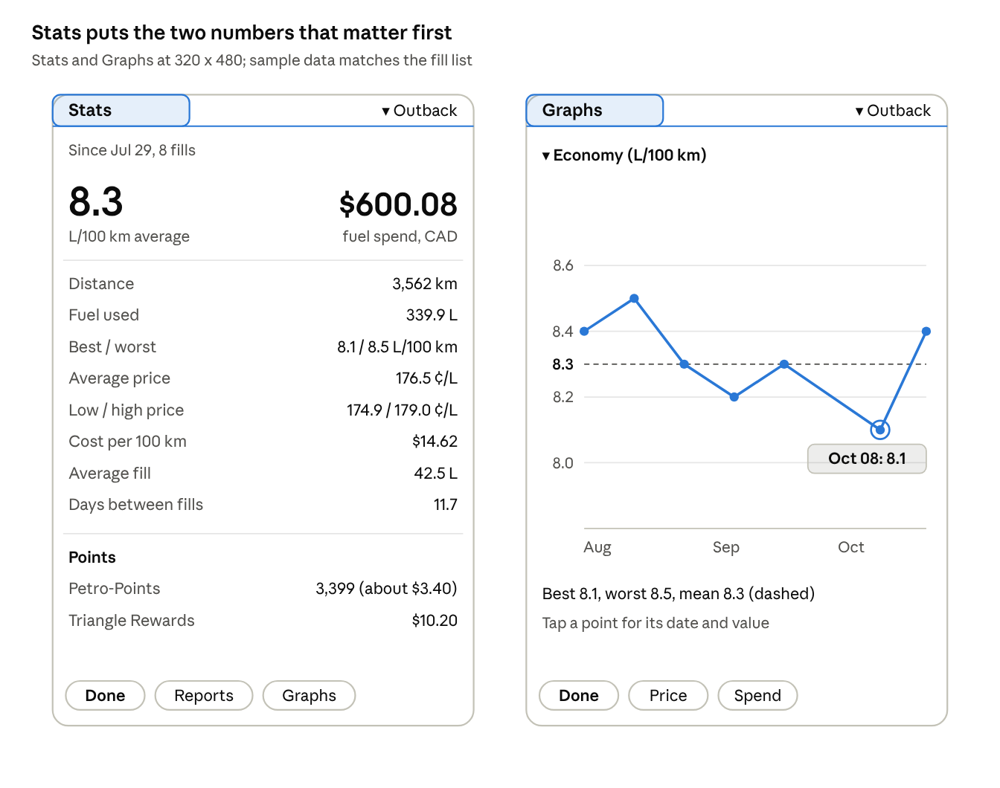

Stats opens on the two numbers people check, average economy and spend, in `largeBoldFont`, with the detail in label-value rows below. The graph keeps one series, a dashed mean and a tap-to-read callout. Price and Spend are one tap away instead of buried in a popup.

## Reports and the Points dialog

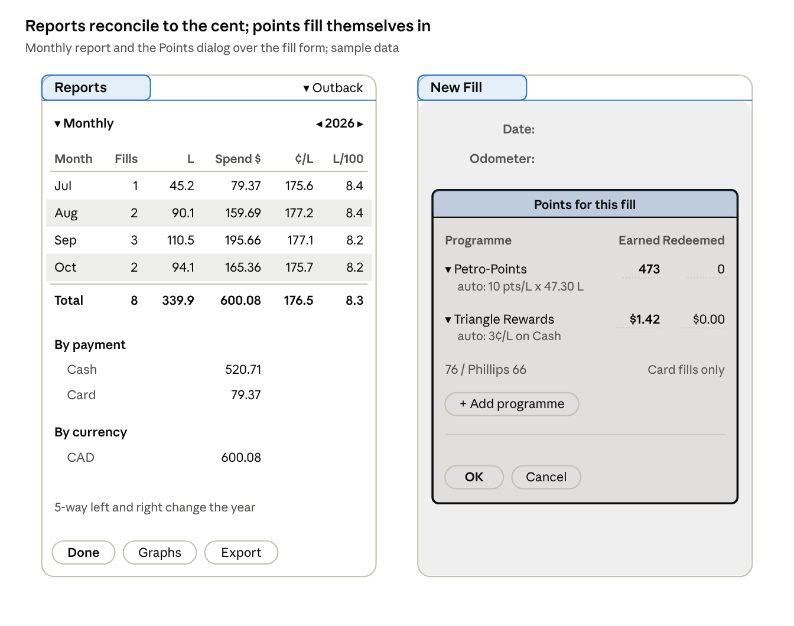

The report's total row reconciles exactly with the Stats screen ($600.08, 339.9 L). The payment and currency splits add back to the same total, so nothing has to be taken on trust. The Points dialog is a standard Palm modal over the dimmed fill form. Each auto-filled line says how it was worked out, and a programme that doesn't apply says why instead of disappearing.

## Service and Log service

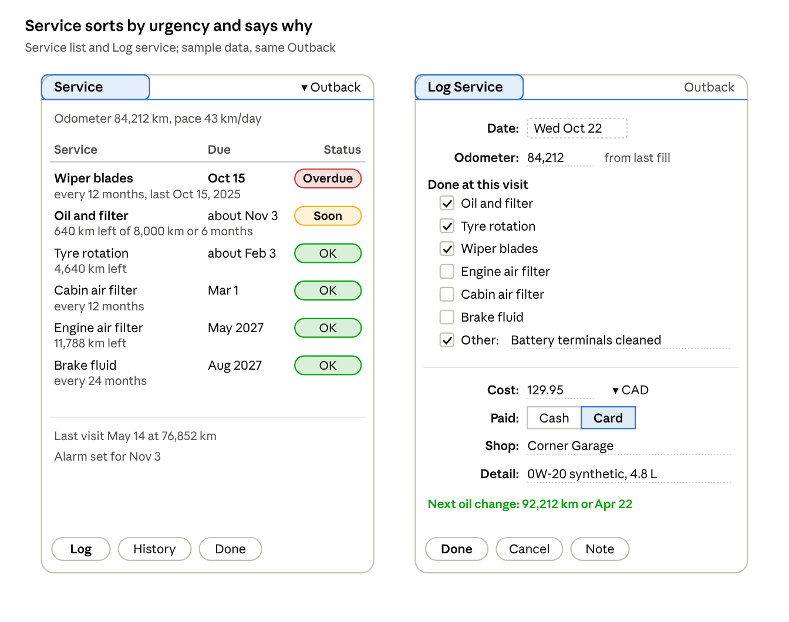

The list is sorted by urgency, not alphabetically, and every row has a second line that explains its date in kilometres or months. Status is a word in a coloured chip, so it still reads on a greyscale screen or for someone colour-blind. Log service previews the next due point before you tap Done, so you can catch a wrong odometer before it skews the countdown.

## Preferences and Edit Vehicle

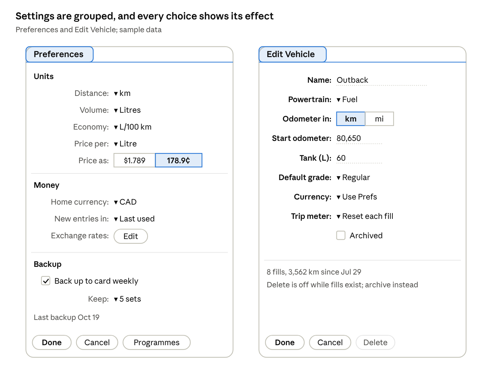

Preferences sit in three groups (Units, Money, Backup). Price as is a push-button pair that shows its own example ($1.789 or 178.9¢), so the choice explains itself. Edit Vehicle keeps per-car overrides beside the car they belong to. Delete is greyed with a one-line reason instead of failing with an alert after the tap.

## Export and Import preview

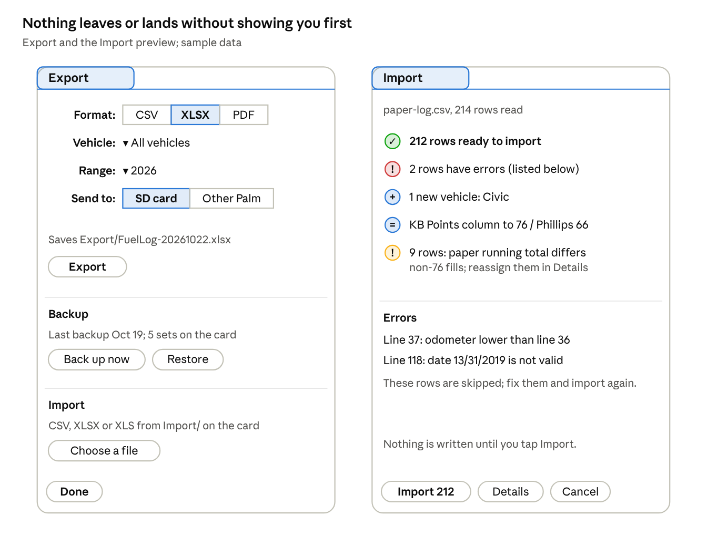

Export puts output, backup and import on one form. It shows the exact file name before you tap, and Other Palm uses the Bluetooth or IR envelope. The Import preview is one line per outcome, with an icon and a count. The KB Points alias and the running-total mismatches from your paper logs are called out, not hidden, and Import shows the number of rows it will write.

## First-run setup and alerts

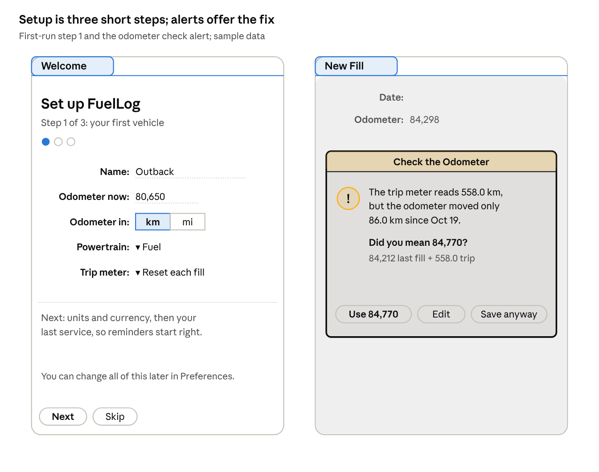

First launch never shows an empty table. Three short steps (vehicle, units and currency, last service) leave the app ready to log, and Skip is always available. Alerts follow one pattern: what FuelLog noticed, its best guess with the working shown, and the fix as the default button. The odometer check offers the corrected number in one tap, so a typo at the pump costs a second, not a bad economy figure.

## Vehicles and Programmes

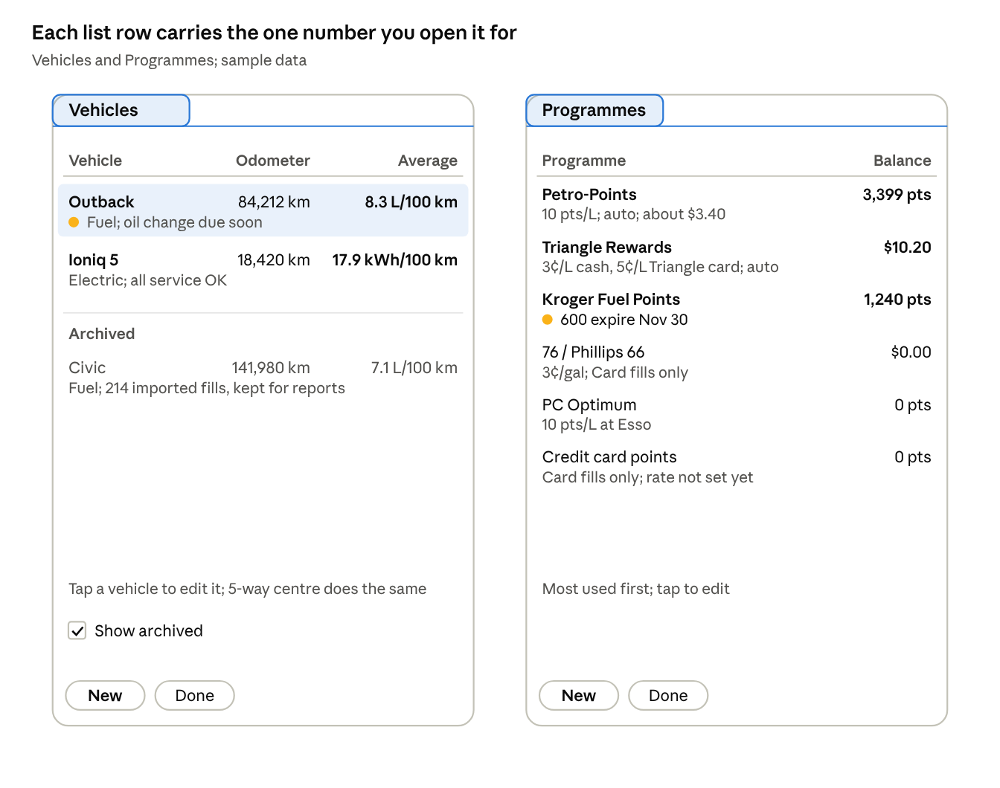

Vehicles shows each car's odometer and average in its own unit (L/100 km or kWh/100 km), with a status line underneath. Archived cars stay visible but quiet, because their history still counts in reports. Programmes are listed most used first. The only warning is the one that costs money: Kroger points about to expire.

## Service history and Service Type

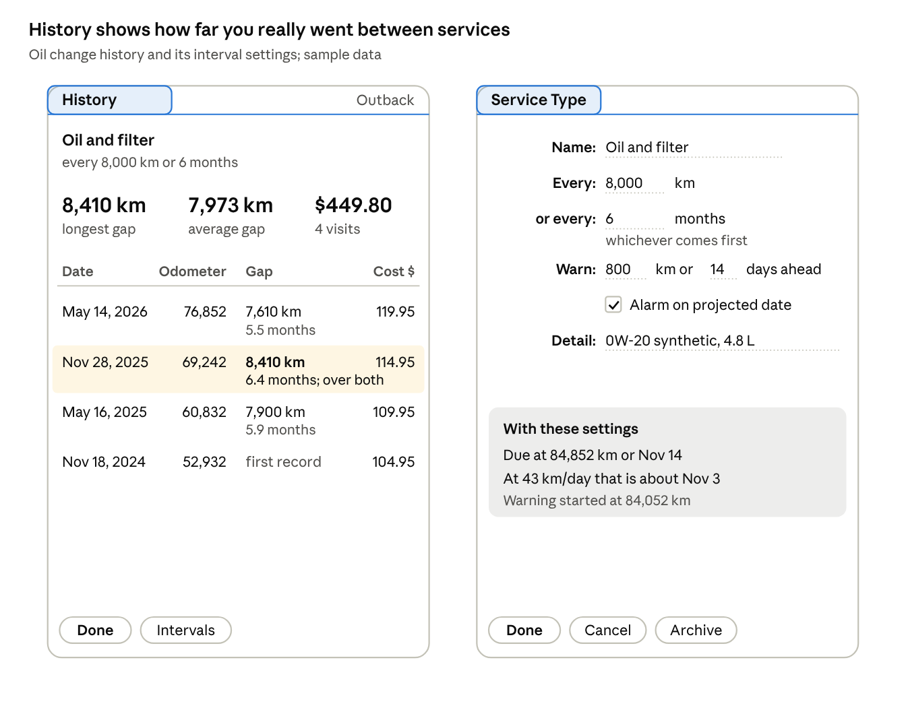

History answers "how far did I really go between oil changes" before you read any row: the longest gap, the average gap and the total spent. The one visit that ran past both limits is tinted and says so. Service Type previews the result of its settings live (due point, projected date, when the warning starts), so you can see an interval's effect before saving it.

## New Charge and Restore

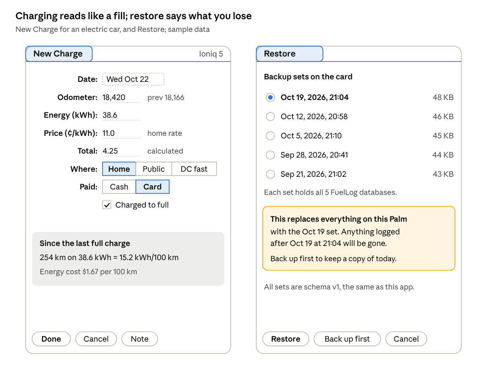

New Charge is the fill form with kWh in place of litres and Where in place of Grade, so there's nothing new to learn. Its preview shows the efficiency and cost per 100 km straight away. Restore names the exact set, says in plain words what will be lost, and offers Back up first as a one-tap way out.

## Edit Programme and Note

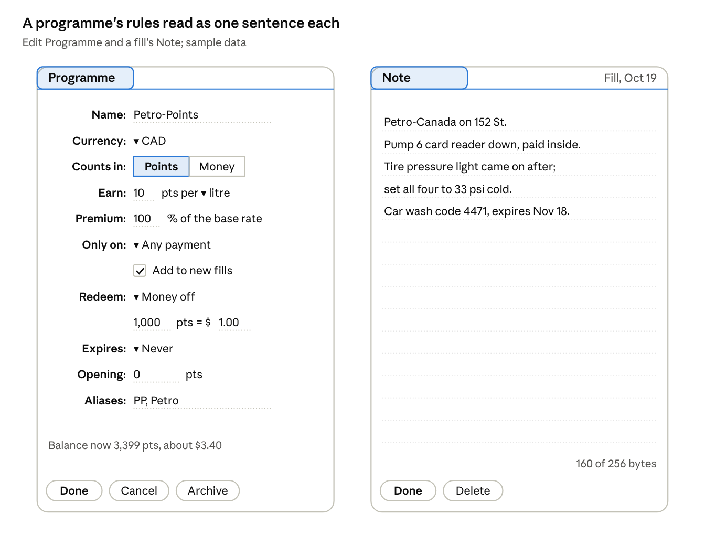

Each programme rule is laid out to read as a sentence: "Earn 10 pts per litre", "1,000 pts = $1.00". That's easier to check against a programme's terms than a grid of codes. Aliases are where KB Points lives for the 76 preset. The Note is the classic Palm lined note with a live byte count, so the 256-byte limit never comes as a surprise.

## Launcher icon

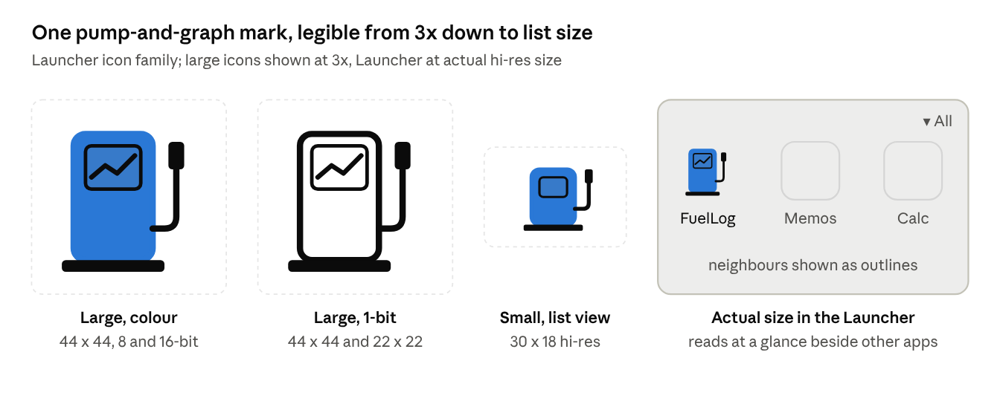

The mark is a fuel pump whose display shows a trend line, which says "fuel" and "log" at once. It is drawn as a bitmap family: 1, 2, 8 and 16-bit at both densities (22 x 22 and 44 x 44 large, 15 x 9 and 30 x 18 small), so the Launcher always picks a native bitmap and never scales one. The 1-bit version keeps the same silhouette for greyscale and older devices. Final pixels are hand-tuned in an icon editor at each size; this vector is the reference.
