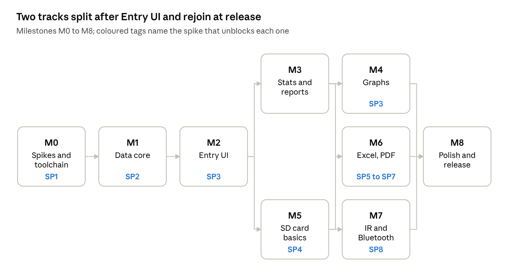

# Backlog

This is the build plan for FuelLog: nine milestones, eight spikes and 36 user stories. Spikes run first so that no milestone starts on an unproven assumption.

## Roadmap

After M2 the work runs in two tracks: reports and graphs on top, card and transfer below. They join at M6, which needs both report output and the SD writers, and everything meets at M8.

## Milestones

Each milestone ends with a .prc that installs and runs on the T|X, plus green host tests. A milestone is done only when its exit criteria hold on the device, not just in the emulator.

| ID | Milestone | Goal | Exit criteria | Needs | Stories |
| --- | --- | --- | --- | --- | --- |
| M0 | Spikes and toolchain | Prove the risky assumptions | SP1 to SP8 closed with written answers; hello-world .prc runs on the T\|X; `make test` runs on macOS; hi-res mock-ups of every form approved (see the Screen designs tab); launcher icon pixels hand-tuned from the reference | none | none |
| M1 | Data core | Databases, maths and settings everything else sits on | three databases create, open and upgrade; calc library passes host tests for all units, currencies and EV; Prefs persist | M0 | US-01 to US-03 |
| M2 | Entry UI | Log real fill-ups daily | a fill is logged in under 20 seconds; vehicles, programmes, currencies, payment and charging all editable on device | M1 | US-04 to US-12 |
| M3 | Stats, reports and service | Answer "how am I doing" on the device, and what service is due | stats match a hand-checked spreadsheet of 50 fills to the cent and to 0.1 L/100 km; service due dates match a hand-worked example for distance, time and projected pace; the alarm fires after a soft reset | M2 | US-13 to US-16, US-33 to US-36 |
| M4 | Graphs | See trends at a glance | three graphs draw at double density in under 1 s for 500 fills | M3 | US-17, US-18 |
| M5 | SD card basics | Get data out, bring paper logs in, never lose it | CSV round-trips; paper-log import works; backup and restore survive a hard reset | M2 | US-19 to US-22 |
| M6 | Excel and PDF | Office-grade outputs and Excel import | XLSX opens clean in Excel and Numbers; PDF opens in Preview and Acrobat; XLSX and XLS import pass fixtures | M5, M3 | US-23 to US-26 |
| M7 | IR and Bluetooth | Move data between Palms and off the device | T\|X to LifeDrive merge with no duplicates; an export sent over Bluetooth lands on the other Palm's SD card | M5 | US-27 to US-29 |
| M8 | Polish and release | Feels native, runs everywhere it should | DIA and 5-way on every form; LifeDrive pass; Go PDB reader ships; v1.0 tagged | M4, M6, M7 | US-30 to US-32 |

## Spikes

Each spike is timeboxed throwaway code that ends in a written answer, not production code. All eight fit in about six working days, and a spike that fails its timebox triggers its fallback instead of eating into a milestone.

| ID | Question | Timebox | Done when | Fallback | Unblocks | Status |
| --- | --- | --- | --- | --- | --- | --- |
| SP1 | Does the jichu4n Homebrew tap build prc-tools on Apple Silicon macOS 27? | 1 day | hello-world .prc built by `make`, installed on the T\|X | `linux/amd64` Docker image with the same tools | M0 | To do |
| SP2 | Can GCC 2.95 `long long` and 32-bit fixed point hold lifetime totals without overflow? | 0.5 day | worst-case bounds written down (20 years, 4 vehicles, 16 programmes) and host-tested | 64-bit only in sums; per-year subtotals | M1 | To do |
| SP3 | Hi-res and DIA on the T\|X: a form that resizes when the input area collapses, drawing at double density | 1 day | one sample form plus a line graph working both ways | fixed 320x320 layout with a scrolling table | M2, M4 | To do |
| SP4 | VFS on the T\|X: write speed, folder creation, `VFSExportDatabaseToFile` round trip | 0.5 day | 200 KB written and timed; exported .pdb re-imported intact | write in smaller chunks; backup via HotSync only | M5 | To do |
| SP5 | Does a stored (uncompressed) zip XLSX made by our writer open clean in Excel and Numbers? | 1 day | host-generated file opens with no repair prompt in both | add sharedStrings or switch to SpreadsheetML 2003 XML | M6 | To do |
| SP6 | Inflate on 68k under PACE: speed and heap for a 200 KB .xlsx | 1 day | timed decode of a Numbers-saved file on the T\|X | decompress to card in passes; or XLSX import via desktop CSV | M6 | To do |
| SP7 | Base-14 PDF from our writer: renders in Preview, Acrobat and iOS? | 0.5 day | a 3-page sample opens in all three with correct euro sign | embed nothing, drop the euro glyph to "EUR" | M6 | To do |
| SP8 | Exchange Manager Palm to Palm: does `_btobex:` from the T\|X reach the LifeDrive, and does a `.fuel` envelope receive with the app closed? | 0.5 day | a 200 KB export crosses by Bluetooth and IR; the receiver writes it to SD; a record `.fuel` opens the import dialog | IR only for v1; move files by SD card swap | M7 | To do |

## User stories

There are 36 stories across M1 to M8, each small enough to finish inside its milestone. Sizes are S (half a day or less), M (one to two days) and L (three to five days). An L that grows past five days is split before it starts.

| ID | M | As a driver, I want to... | So that... | Acceptance criteria | Size | Status |
| --- | --- | --- | --- | --- | --- | --- |
| US-01 | M1 | have my log stored in metric fixed point | switching units never changes my data | stored bytes identical after every unit switch; conversions round-trip within 0.1 of the display unit | M | To do |
| US-02 | M1 | pick distance, volume, economy and price units separately, with an odometer unit per vehicle | the app reads the way I think and the way each car's dash reads | every screen, report and export follows Prefs; a miles-odometer car is entered in miles | M | To do |
| US-03 | M1 | set a home currency and keep a rate per currency | trips across the border still roll up into one total | USD, CAD, EUR, AUD, NZD and GBP selectable; default currency for new entries set in Prefs (fixed or last used) with a per-vehicle override; fxRate stored per fill; totals unchanged when rates are edited later | M | To do |
| US-04 | M2 | log a fill-up from New in a few taps | logging at the pump is quicker than paper | date, vehicle, payment and grade pre-filled; any two of volume, price and total compute the third; under 20 s end to end | L | To do |
| US-05 | M2 | edit or delete a past fill | mistakes don't poison my stats | delete asks first; balances and economy recalculate at once | S | To do |
| US-06 | M2 | mark a fill as full tank or after a missed fill | economy stays honest | missed fill breaks the chain; partial fills roll into the next full; trip meter reading cross-checks the odometer and warns on a gap over 2%; blank odometer derived from trip | S | To do |
| US-07 | M2 | record points for several programmes on one fill | linked programmes such as Petro-Points and Triangle Rewards both count | up to 4 programmes per fill; auto-apply pre-fills by earn rule and payment; every line editable; per-gallon or per-litre redemptions (Kroger, PC Optimum) compute the discount within the volume and per-unit caps | M | To do |
| US-08 | M2 | add, rename and archive vehicles with powertrain, tank or battery, and odometer unit | the whole household fleet lives in one log | up to 16 vehicles; delete blocked while fills exist; archived cars hidden but reportable | M | To do |
| US-09 | M2 | manage rewards programmes, starting from the presets | I track the programmes I actually use | 6 presets (incl. Kroger Fuel Points for Fred Meyer and King Soopers) ship with known default earn, redemption and expiry rules; add, edit, archive; money-valued programmes show dollars | M | To do |
| US-10 | M2 | log a charging session for an EV or plug-in hybrid | electricity costs sit beside fuel | kWh, price per kWh (0 allowed), home, public or DC fast, charged-to-full flag; home rate pre-fills | M | To do |
| US-11 | M2 | record Cash or Card for each fill | I can see how I pay and card points only apply to card fills | push group defaults to last used; programmes with `requiresPayment` follow it | S | To do |
| US-12 | M2 | enter a fill in its receipt currency | receipts match the log exactly | currency popup on the form; rate pre-filled from the table and editable | S | To do |
| US-13 | M3 | see lifetime stats for one vehicle or all on one screen | I know my numbers at a glance | the Stats table from the spec fits one hi-res screen; matches the hand-checked fixture | M | To do |
| US-14 | M3 | run monthly, yearly and custom-range reports | I can compare periods | period popup; 5-way steps through periods; per-vehicle breakdown under All vehicles | M | To do |
| US-15 | M3 | see each programme's balance and its value | I know what my points are worth | balance = opening + earned - redeemed per programme; value shown when set; adjustments counted; savings from redemptions totalled; points expiring this month flagged | S | To do |
| US-16 | M3 | see spend split by currency and by payment method | cross-border and cash spending is visible | report sections for each; totals reconcile to the home-currency total | S | To do |
| US-17 | M4 | graph economy over time and tap a point for its value | I spot trends and outliers | full-to-full segments plotted; min, max and mean labelled; tap shows date and value | L | To do |
| US-18 | M4 | graph price per fill and spend per month, one line per vehicle | I see where the money goes | popup switches graph; All vehicles draws a line per car; under 1 s for 500 fills | M | To do |
| US-19 | M5 | export the log to CSV on the SD card | I can open it in any spreadsheet | file in `Export/`; UTF-8 with BOM; header with units; respects filters | S | To do |
| US-20 | M5 | import my filled paper logs from CSV | years of history come with me | preview with errors and line numbers before writing; units read from header; re-import adds no duplicates | L | To do |
| US-21 | M5 | back up to SD on demand and automatically | I never lose the log | dated set of 3 PDBs; keeps last 5; auto after 7 days on exit; HotSync backup bit set | M | To do |
| US-22 | M5 | restore from a backup set | a lost or reset Palm is recoverable | lists sets; confirm before replacing; newer schema refused; older schema migrated | M | To do |
| US-23 | M6 | export to XLSX with Fills, Monthly, Vehicles and Programmes sheets | I get a real workbook, not text | numbers and dates are typed cells; currency formats applied; opens with no repair prompt | L | To do |
| US-24 | M6 | export a PDF report laid out like the paper log | I can print or file it | summary page, log pages, economy graph; Letter landscape; euro sign renders | L | To do |
| US-25 | M6 | import an XLSX workbook | spreadsheets from Excel or Numbers load directly | reads Fills or first sheet; 1900 and 1904 date systems; own export round-trips exactly | L | To do |
| US-26 | M6 | import an old XLS workbook | older files need no conversion | BIFF8 cells and cached formula values read; same preview and merge as CSV | L | To do |
| US-27 | M7 | beam a fill, vehicle or programme over IR | sharing with another Palm is instant | `.fuel` received with app closed; merge offered; duplicate beam is a no-op | M | To do |
| US-28 | M7 | send my whole log to my other Palm and merge | the T\|X and LifeDrive agree | all three databases in one bundle; Merge or Replace; ids remapped on clash | M | To do |
| US-29 | M7 | send an export over Bluetooth to another Palm | the other Palm gets the report without swapping cards | CSV, XLSX or PDF sent in a `.fuel` envelope; the receiver writes it to its `Export/` folder with the original name; CSV and XLSX offer import | S | To do |
| US-30 | M8 | use the full 320x480 screen and the 5-way everywhere | it feels like a native T\|X app | every form resizes on DIA collapse; 5-way moves and selects on all lists and forms | M | To do |
| US-31 | M8 | run FuelLog on the LifeDrive and older 68k Palms | my other devices work too | full pass on LifeDrive; launches low-res in CloudpilotEmu without crashing | S | To do |
| US-32 | M8 | read FuelLog backups on my Mac with a Go tool | my data is never locked in the Palm | `fuellog dump` prints fills as CSV from the three PDBs; matches device export | M | To do |

**Service tracking** (added to M3; it needs the M2 entry UI and the fill odometer)

| ID | M | As a driver, I want to... | So that... | Acceptance criteria | Size | Status |
| --- | --- | --- | --- | --- | --- | --- |
| US-33 | M3 | set a maximum distance and time between oil changes, and other services, per vehicle | each car follows its own manual | presets by powertrain; intervals blank until set; warn-ahead defaults 10% and 14 days; first-use asks for the last service date and odometer | M | To do |
| US-34 | M3 | log a service visit covering several items at once | one shop visit is one entry | checklist of service types plus Other with free text (up to 24 characters, promotable to a tracked type); odometer pre-filled from latest fill; cost, currency, Cash/Card, shop, detail | M | To do |
| US-35 | M3 | see what is due soon or overdue, and be reminded when FuelLog is closed | I never run past an oil change | Service list shows km and days left and projected date at 90-day pace; wrench on fill list; one alert when a fill tips into Due soon; `AlmSetAlarm` set and restored after reset | L | To do |
| US-36 | M3 | see service history, the longest gap I actually reached, and running cost | I know how I really maintain each car | history per service with over-interval gaps flagged; running cost per 100 km (fuel plus service); Services sheet, CSV and PDF page in exports | M | To do |

## Definition of done

A story is done only when every box below holds on the real T|X. That is how polish is enforced throughout the build instead of being left to M8.

- [ ] Acceptance criteria met on device, not only in CloudpilotEmu
- [ ] Form matches its approved hi-res mock-up in the Screen designs tab; aligned to the grid; numbers right-aligned on the decimal
- [ ] Resizes cleanly when the input area collapses and opens; nothing clipped in the 320x320 fallback
- [ ] 5-way reaches every control with a visible focus ring; centre selects
- [ ] Colours come from the device Colour Theme; status never shown by colour alone
- [ ] No flicker on scroll or redraw; launch and save inside the speed targets
- [ ] Every error path shows a plain-words alert that says what to do next
- [ ] Empty state written; Tips (?) text written
- [ ] Host unit tests green; no new compiler warnings
- [ ] State restored after switching apps, and after an interruption mid-entry
